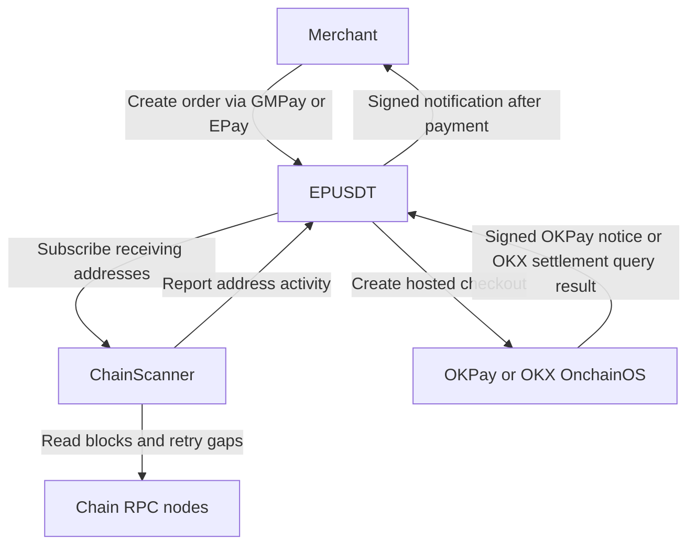
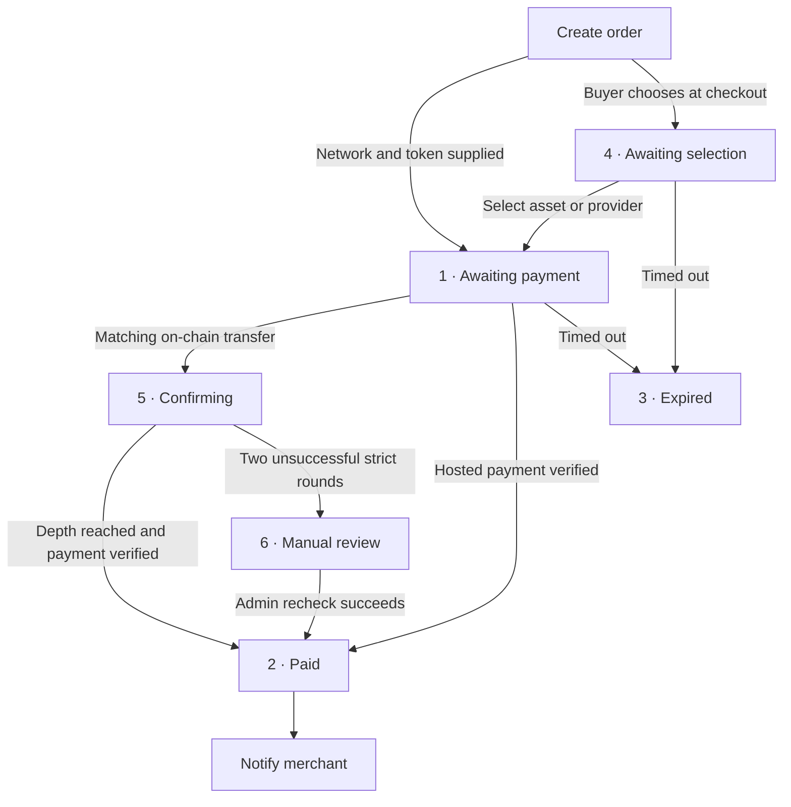

<div align="center">


# EPUSDT

**A self-hosted crypto payment gateway for merchants**

<p><strong>English</strong> · <a href="./README.zh_CN.md">简体中文</a></p>

<p>
  <a href="wiki/API.en.md">Merchant API</a> ·
  <a href="wiki/README.md">Documentation</a> ·
  <a href="https://t.me/epusdt">Telegram channel</a> ·
  <a href="https://t.me/epusdt_group">Telegram group</a>
</p>

<p>
  <a href="LICENSE"></a>
  <a href="https://github.com/GMWalletApp/epusdt/releases/latest"></a>
  <a href="https://hub.docker.com/r/gmwallet/epusdt"></a>
</p>

</div>

---

## Deploy or migrate to EPUSDT

Copy the prompt below and paste it into Codex, Claude Code, Cursor OpenCode and so on...

```text
Read https://epusdt.com/agent-setup/prompt.md. Inspect my target environment first, then deploy, upgrade or migrate to EPUSDT (GMPay) using Docker. Preserve existing data. For a new instance, open the setup wizard and let me complete password setup myself.
```

[Read the deployment checklist](https://epusdt.com/agent-setup/prompt.md)

## Overview

EPUSDT is a self-hosted crypto payment gateway written in Go. Merchants create orders through the GMPay or EPay-compatible API. Buyers pay the merchant’s wallet, and EPUSDT verifies the transfer before notifying the merchant. Merchants can rotate receiving addresses and receive payment notifications through the Telegram bot.



<a id="screenshots"></a>

## Interface preview

| Dashboard | Admin console |
| :---: | :---: |
| <a href="./wiki/img/web2.png"></a> | <a href="./wiki/img/web1.png"></a> |
| **Checkout** | **Payment page** |
| <a href="./wiki/img/pay1.jpeg"></a> | <a href="./wiki/img/pay2.jpeg"></a> |

<a id="networks"></a>

## Supported Networks and Tokens

A fresh installation includes the 16 direct-payment networks below. Checkout offers a network when it is enabled, has a receiving address and has an enabled asset configured for payment. Integrations can read `data.supported_assets` from `GET /payments/gmpay/v1/config` for the network IDs and token symbols available on their instance.

| Network | API network ID | Default assets |
| --- | --- | --- |
| TRON | `tron` | TRX, USDT |
| Ethereum | `ethereum` | USDT, USDC |
| BNB Smart Chain | `binance` | USDT, USDC |
| Polygon PoS | `polygon` | USDT, USDC, USDC.e |
| Solana | `solana` | SOL, USDT, USDC |
| TON | `ton` | TON, USDT |
| Plasma | `plasma` | USDT |
| Aptos | `aptos` | USDT, USDC |
| Sui | `sui` | SUI, USDC |
| Arbitrum One | `arbitrum` | ETH, USDC, USDT |
| Base | `base` | ETH, USDC |
| OP Mainnet | `optimism` | ETH, USDC |
| Avalanche C-Chain | `avalanche` | AVAX, USDC |
| HyperEVM | `hyperevm` | HYPE, USDC |
| Monad | `monad` | MON, USDC |
| Arc | `arc` | USDC |

Polygon has separate USDC and USDC.e assets. EPUSDT uses the payment symbol `USDT` for USDT0 on Arbitrum One and Plasma. Arc accepts USDC via both native and ERC-20 transfers.

<a id="checkout"></a>

## Hosted checkout

Merchants enable these payment methods separately. The public config endpoint exposes their status and allowed tokens in `xlayer` and `okpay`.

- **OKX OnchainOS (X Layer)** supports USDC, USDT0 and USDG. Enter your OKX API key, secret, passphrase and X Layer receiving address in the admin console, then select the tokens to accept. Buyers pay on the OKX checkout page. EPUSDT verifies the order when OKX reports `settled`.
- **OKPay** allows USDT and TRX by default. Checkout displays the tokens enabled by the merchant.

## Order lifecycle



For direct transfers, EPUSDT matches the chain, asset, receiving address, amount and payment window. Strict verification is enabled by default and requires matching results from two independent nodes. Confirmation depth and order matching still apply when strict mode is disabled. A transfer made within the payment window can be picked up by a later backfill, even after the order has expired.

<a id="quick-start"></a>

## Getting started

1. Install EPUSDT using the [Linux installer](wiki/EPCTL.en.md) or [Docker Compose](wiki/docker-RUN.en.md).
2. Enable a network and its assets in the admin console, then add a receiving address on that network.
3. Read `GET /payments/gmpay/v1/config` to check available assets, then create an order using the [merchant API guide](wiki/API.en.md).

<a id="deployment"></a>

## Installation and upgrades

For Linux binary installation and upgrades, follow the [epctl guide](wiki/EPCTL.en.md). Other options include [Docker Compose](wiki/docker-RUN.en.md), [aaPanel](wiki/BT_RUN.en.md) and [manual installation](wiki/manual_RUN.en.md). When upgrading Compose from v2.0.0, back up and migrate the data to the new mount before recreating the container. [v2.1.0 upgrade notes](https://github.com/GMWalletApp/epusdt/releases/tag/v2.1.0)

### Database and upgrades

EPUSDT supports SQLite only. New installations can omit `db_type` or set `db_type=sqlite`. EPUSDT creates the tables on first startup.

| Contents | Setting | Default location |
| --- | --- | --- |
| Business data (orders, wallets, merchant settings) | `sqlite_database_filename` | `epusdt.db` next to the configuration file |
| Runtime state (including transaction locks) | `runtime_sqlite_filename` | `epusdt-runtime.db` under `runtime_root_path` |

Back up the configuration and both databases when upgrading. If using the embedded ChainScanner, also retain `chainscanner.sqlite` in the runtime directory for its subscriptions, scan progress and node settings. For a legacy MySQL or PostgreSQL deployment, back up, migrate and verify your data before switching to SQLite. Changing `db_type` does not convert historical data.

## ChainScanner integration

ChainScanner starts inside EPUSDT with automatically generated credentials. It reads blocks across nodes, switches nodes after failures and retries missing blocks. The dashboard shows scanned height, target height and observed lag, with a warning above five minutes.

<details>
<summary>Standalone deployment and node management</summary>

Docker Compose starts the embedded scanner by default. Existing standalone Compose deployments can keep their scanner data volume, credentials and service URL and run `docker compose --profile scanner up -d` to retain subscriptions and cursors. For a new standalone service, supply separate consumer and administrator tokens and set `CHAINSCANNER_URL=http://chainscanner:9081` for EPUSDT.

EPUSDT starts ChainScanner in-process by default, using a private loopback port and automatically generated credentials. Subscriptions, cursors and node settings persist in `chainscanner.sqlite` in the EPUSDT runtime directory. To use a standalone scanner instead, configure its HTTP(S) origin in `CHAINSCANNER_URL` and a dedicated consumer credential in `CHAINSCANNER_TOKEN`. Set a separate `CHAINSCANNER_ADMIN_TOKEN` for scan progress, node diagnostics and blacklist management. Configure persistent scanner storage and reconcile pending orders when migrating. The default event transport is WebSocket. Set `CHAINSCANNER_TRANSPORT=grpc` for bidirectional streaming or `http` for long polling.

You can configure fallback nodes from two independent providers per network for retries and strict verification. [ChainScanner API](chainscanner/docs/api/en.md) · [Upstream project](https://github.com/GMWalletApp/ChainScanner) · [Pinned revision](chainscanner.rev)

</details>

<a id="documentation"></a>

## Integrations

<details>
<summary>Compatible platforms</summary>

- **AI Distribution** — [OneAPI](https://github.com/songquanpeng/one-api), [Sub2API](https://github.com/Wei-Shaw/sub2api), [NewAPI](https://github.com/QuantumNous/new-api)

- **Card/Voucher Platforms** — [Dujiaoka](https://dujiao-next.com/), [ACG Faka](https://github.com/lizhipay/acg-faka)

- **Proxy Panels** — [V2Board](https://github.com/v2board/v2board), [XBoard](https://github.com/cedar2025/Xboard), [xiaoV2board](https://github.com/wyx2685/v2board/), [SSPanel](https://github.com/anankke/sspanel-uim)

- **Website Ecosystem** — [WordPress](https://wordpress.com/), [WHMCS](https://www.whmcs.com/)

- **Epay-Compatible Flow** — Works with platforms already using Epay-style payment interfaces

</details>

Related projects on Cloudflare Workers include the [GMPay Edge payment gateway](https://github.com/GMWalletApp/gmpay-edge) and the [GMShop Edge digital storefront](https://github.com/GMWalletApp/gmshop-edge).

<details>
<summary>Star History</summary>

<a href="https://www.star-history.com/?type=date&repos=gmwalletapp%2Fepusdt">
 <picture>
   <source media="(prefers-color-scheme: dark)" srcset="https://api.star-history.com/chart?repos=gmwalletapp/epusdt&type=date&theme=dark&legend=top-left" />
   <source media="(prefers-color-scheme: light)" srcset="https://api.star-history.com/chart?repos=gmwalletapp/epusdt&type=date&legend=top-left" />
   
 </picture>
</a>

</details>

[Report an issue](https://github.com/GMWalletApp/epusdt/issues) · [Project website](https://epusdt.com)

## Audit and license

[VectorBits audit report (May 2026)](https://github.com/VectorBits/audit/blob/main/epusdt-secure-audit-report-2026-05-14.pdf) · [GPLv3 license](LICENSE)

<details>
<summary>Disclaimer and Terms of Use</summary>

EPusdt is developed and published by Good Morning Technology, LLC as free, open-source, non-profit, and non-custodial software for learning, research, and technical communication. Nothing in this project constitutes investment, financial, legal, tax, compliance, or any other professional advice, nor should it be interpreted as a guarantee regarding any asset, transaction outcome, revenue, fund safety, technical availability, or fitness for a particular purpose.

Good Morning Technology, LLC is an entity organized under United States law and will comply with applicable legal and regulatory obligations as required. Under U.S. regulatory frameworks, whether virtual currencies, digital assets, or related technical services constitute money transmission, a money services business (MSB), or another regulated activity generally depends on the specific business model, including whether the operator receives, holds, controls, or transmits funds or value, provides custody on behalf of users, or engages in exchange, payment, clearing, settlement, or other intermediary financial services.

As a free, open-source, non-profit, and non-custodial software project, the source code, documentation, technical communication, and related development activities of EPusdt should not be interpreted as authorization, endorsement, control, participation, warranty, or commitment by Good Morning Technology, LLC or its contributors regarding any user's downstream use, modification, deployment, integration, distribution, or secondary development.

Users independently determine how they use this project, for what purpose, and in what context. Good Morning Technology, LLC and its contributors cannot control, review, or restrict such conduct. Users are solely responsible for ensuring that their use, modification, deployment, integration, distribution, or derivative development complies with applicable laws, regulations, sanctions rules, and third-party rights in the relevant jurisdictions, and they bear all resulting risks, liabilities, and consequences.

Crypto assets are a high-risk emerging asset class. Stablecoins and other digital assets may experience sharp volatility, de-pegging, insufficient liquidity, technical failures, regulatory changes, or total loss of value. All code, documentation, and related materials in this project are provided on an "as is" and "as available" basis. Except where mandatory law provides otherwise, Good Morning Technology, LLC and its contributors are not liable for any direct or indirect loss resulting from use, inability to use, misuse, unlawful use, modification, deployment, integration, distribution, derivative development, or reliance on this project.

</details>
