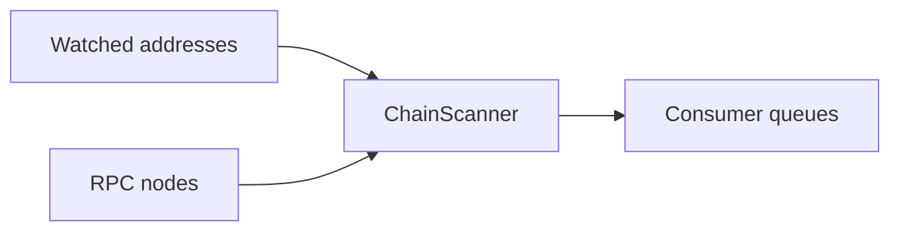

# ChainScanner · Deployment guide

[Home](../../README.md) · [Quick start](#quick-start) · [Networks](#networks) · [API reference](../api/en.md)

<a id="quick-start"></a>

## Quick start

From the repository root, build the server with Go 1.25 or later. The example uses Base and a local SQLite file. Use a fresh checkout and a shell with `openssl`, `curl` and `jq`.

```sh
go build -o chainscanner ./cmd/chainscanner
umask 077
cat > chainscanner.json <<EOF
{
  "listen": "127.0.0.1:9081",
  "database": "chainscanner.sqlite",
  "networks": [{"name": "base", "confirmations": 3}],
  "consumers": {"payments": "$(openssl rand -hex 32)"},
  "admin_token": "$(openssl rand -hex 32)"
}
EOF
./chainscanner -config chainscanner.json
```

In a second terminal in the same directory, replace the sample address with a Base address you want to follow. Save the returned `from_height`; it is the first eligible height, inclusive.

```sh
BASE=http://127.0.0.1:9081
TOKEN=$(jq -r '.consumers.payments' chainscanner.json)
ADDRESS=0x1111111111111111111111111111111111111111
jq -nc --arg a "$ADDRESS" '[{network:"base",address:$a}]' |
  curl -sS -X PUT "$BASE/v1/subscriptions" -H "Authorization: Bearer $TOKEN" -H 'Content-Type: application/json' --data-binary @-
```

Poll the queue. An empty response (HTTP 204) means no matching delivery arrived during the wait. When a delivery arrives, persist your business result, then acknowledge its `id` using the API reference.

```sh
curl -i -sS -H "Authorization: Bearer $TOKEN" "$BASE/v1/events/next?network=base&wait=15"
```

[API reference](../api/en.md)

<a id="configuration"></a>

## Configuration

| Setting | Behavior |
| --- | --- |
| `listen` | Defaults to `127.0.0.1:9081`. Use TLS when exposing the bearer-authenticated API. |
| `database` | Omit for in-memory operation. A file retains watches, gaps and unacknowledged deliveries across restarts. Keep the file and its WAL on persistent storage. Only one process may own the file. |
| `networks[].name` · `url` | One entry per concrete network. An optional URL takes priority at startup. A network with catalog nodes can be enabled by name alone. |
| `confirmations` | Required depth before delivery. The scan frontier is `tip - max(confirmations - 1, 0)`. On an L2 this counts L2 blocks. |
| `lookback` | A positive value includes recent eligible history on activation. By default the first watch starts at the observed tip plus one. |
| `interval_seconds` | Polling interval, 5 seconds by default. Supported streams also wake an active worker on new heads. |
| `protocol` · `api_key` · `history_url` · `history_api_key` | Choose an interface from the table below. Set `history_url` for paired transports. Its credentials are independent of the primary URL. |
| `trace_calls` | Enable internal EVM call evidence with execution JSON-RPC and a provider supporting the call tracer. |
| `consumers` · `admin_token` | Map consumer names to distinct tokens of at least 24 bytes. An optional, separate admin token enables node management. |
| `blacklist` | Use `keyword:acme` for a case-insensitive substring of the hostname, `exact:rpc.example.org` for a single host, or an unprefixed domain to include subdomains. The same spelling works in the configuration and both admin routes. Paths, credentials and query strings are excluded from keyword matching. [API](../api/en.md#blacklist) |

<a id="asset-events"></a>

### EVM token events

The scanner uses logs already fetched for each block. On Ethereum mainnet it also matches the non-indexed `user` of the Aave V3 Core Pool's `Supply` event. For Lido's stETH `TokenRebased`, subscribe once to the stETH token contract and check `activity.data.refresh_assets` for its address. A balance service can then reread stETH for the holders it tracks. Subscribing to a holder address alone cannot discover a rebase that does not name that holder. Refresh hints are deduplicated per transaction and carry no amount. [Aave event ABI](https://github.com/aave/aave-v3-core/blob/master/contracts/interfaces/IPool.sol) · [stETH integration guide](https://docs.lido.fi/guides/lido-tokens-integration-guide/)

For another trusted deployment, add `asset_events` to its entry in `networks`. Keys are the emitting contract address (use the proxy for delegated execution) and the 32-byte Keccak hash of the event signature. This example assumes `event RewardPaid(address beneficiary, uint256 amount)` with both arguments non-indexed. Replace the example contract with the deployed rewards contract.

```json
{
  "name": "base",
  "asset_events": {
    "0x2222222222222222222222222222222222222222": {
      "0xe2403640ba68fed3a2f88b7557551d1993f84b99bb10ff833f0cf8db0c5e0486": {
        "topics": 1,
        "data_words": 2,
        "address_words": [0]
      }
    }
  }
}
```

`topics` is the exact topic count including the signature. `data_words` is the exact number of static 32-byte data words. `address_words` lists zero-based positions declared as addresses in the verified ABI. Use `refresh_asset: true` when the emitting token changes balances globally. Configure at least one address position or a refresh hint. A custom rule replaces the built-in layout for that exact network, contract and signature. Configured layouts support fixed-size payloads only.

<a id="networks"></a>

## Networks and transports

EVM mainnets share an adapter. Set the exact network ID in every watch and node entry. Connections verify the execution chain ID. All 12 support JSON-RPC over HTTP or WebSocket, local IPC and Geth-compatible GraphQL. Ethereum also supports Beacon SSE paired with execution HTTP.

| Network | ID | Chain ID |
| --- | --- | --- |
| Ethereum | `ethereum` | 1 |
| Arbitrum One | `arbitrum` | 42161 |
| BNB Smart Chain | `binance` | 56 |
| Avalanche C-Chain | `avalanche` | 43114 |
| Polygon PoS | `polygon` | 137 |
| OP Mainnet | `optimism` | 10 |
| Base | `base` | 8453 |
| HyperEVM | `hyperevm` | 999 |
| Monad | `monad` | 143 |
| Arc | `arc` | 5042 |
| Plasma | `plasma` | 9745 |
| Robinhood Chain | `robinhood` | 4663 |

| Network | Protocols | Activity and history |
| --- | --- | --- |
| `bitcoin` | `jsonrpc` · `http` | Spent prevouts, recipients and change. Requires full blocks with undo data. |
| `tron` | `http` · `rest` · `grpc` · `solidity-http` · `solidity-grpc` · `jsonrpc` | Wallet transfers, receipts and internal transfers. WalletSolidity reads solidified blocks. JSON-RPC needs a Wallet HTTP history URL. |
| `solana` | `http` · `jsonrpc` · `ws` · `grpc` | Finalized slots, transaction accounts and SPL owners. PubSub and Yellowstone require HTTP history for full blocks and skipped slots. |
| `sui` | `grpc` · `graphql` | Native Move checkpoints, senders, sponsors, owners and events. The HTTPS default uses gRPC v2. |
| `aptos` | `http` · `rest` · `grpc` · `graphql` | Native Move ledger versions, signers, events and write sets. Both RawData gRPC and Indexer GraphQL need fullnode REST history. |
| `ton` | `lite` · `rest` · `jsonrpc` | Masterchain and shard activity, accounts and message endpoints. Lite accepts a global config URL or a single peer in the form `adnl://IP:port/base64url-public-key`. The built-in mainnet peers have independent health and retry records. TON Center v2 uses `/api/v2` or `/api/v2/jsonRPC` and must serve block BOCs. |

```json
{
  "name": "solana",
  "protocol": "ws",
  "url": "wss://api.mainnet-beta.solana.com",
  "history_url": "https://api.mainnet-beta.solana.com"
}
```

<a id="recovery"></a>

## Scanning and recovery



The first subscription starts its chain. Removing the final address fixes the last covered block. The worker waits for confirmations, repairs earlier gaps and queues all matching events through that block before clearing the chain cursor and gaps. Queued events remain available until acknowledged. A configured database file preserves unfinished work across restarts. In memory mode, consumers must reconcile interruptions.

If block 101 is missing, activity in 102 and 103 can already reach consumers. The height API stays at 100 until 101 completes. A new subscription starts after the highest assigned height, so earlier gaps retain their original subscriber boundaries.

Each network keeps up to 32 outstanding ranges and uses up to eight distinct history endpoints. A stream signal or poll triggers a head check on a free lane. Its height and latency also update health for direct endpoints. A node can read a range ending at height B when its recent head is at least B + confirmations − 1. With four confirmations a node at 105 can scan through 102, while a node at 106 can scan through 103. Unknown or stale nodes receive a probe first. Lower nodes can repair earlier gaps.

Each completion frees a lane for more work, including newly confirmed blocks while an older request is still running. Errors and deadlines trigger retries on another eligible provider. Shared history URLs take turns. Solana reuses a list of up to 16 finalized slots per history source and keeps block reads and delivery independent.

In the source tree, `internal/nodes/live.go` owns the watch-period queue, `health.go` shares head observations, and `worker.go` handles provider reads. `internal/engine` reserves gaps and commits matching deliveries. `internal/feed` exposes the HTTP, WebSocket and gRPC interfaces.

Every three consecutive failures of the same operation trigger a cooldown of 1, 3, 6, 10, 15 minutes and so on, capped at one hour. A successful height check resets only height failures; reading a range successfully resets both streaks.

The standalone server refreshes ChainList at startup and every 15 minutes, including while workers are idle. It probes public EVM HTTPS/WSS nodes, checks chain ID and recent headers, and preserves operator-owned entries. A failed catalog download leaves the previous inventory intact. The UniSat Bitcoin entry supports height probes only.

CompareNodes adds free, keyless mainnet endpoints for every supported scanning network at startup and every 15 minutes. The server reads each protocol’s public directory page, filters by transport and verifies the chain and a recent block using anonymous requests. A failed page fetch or invalid table preserves that chain’s previous inventory. Directory removals affect only entries owned by CompareNodes. Commercial use of the directory requires permission under the [CompareNodes terms](https://www.comparenodes.com/terms-of-use/).

OpenChainBench supplements ChainList for Solana, Sui, Aptos and TON. The server reads its public HTTP API and benchmark definitions every 15 minutes, then checks recent transactions before adding a node. Each directory manages its own entries. A failed probe or upstream removal retires a discovered node. A directory download error preserves the previous list for that chain. [OpenChainBench](https://openchainbench.com/benchmarks)

<details>
<summary>Transport details</summary>

For TLS gRPC use `grpcs://host:port` or `https://host:port`; plaintext uses `grpc://host:port`. Ethereum Beacon SSE uses the provider’s `/eth/v1/events` route, IPC accepts a local Unix socket, and GraphQL takes the full endpoint URL. A WebSocket execution node must also serve normal RPC reads.

EVM matching covers transaction endpoints, created contracts, log emitters and address-shaped indexed topics. Optional traces can reveal internal calls with no logs. Arbitrum Nova, HyperCore trading and Avalanche X/P chains have separate ledgers. A matching transaction can be outgoing or unsuccessful. Check the evidence before crediting a payment.

</details>

<a id="go"></a>

## Go integration

Import the root package to embed the scanner or use its HTTP client. Run the race-enabled test suite from the repository root.

```go
import scanner "github.com/GMWalletApp/ChainScanner"
```

```sh
go test -race ./...
```

[API reference](../api/en.md) · [scanner.go](https://github.com/GMWalletApp/ChainScanner/blob/main/scanner.go) · [MIT](https://github.com/GMWalletApp/ChainScanner/blob/main/LICENSE)
