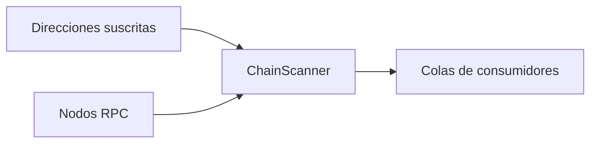

# ChainScanner · Guía de despliegue

[Inicio](../../README.es.md) · [Inicio rápido](#quick-start) · [Redes compatibles](#networks) · [Referencia de la API](../api/es.md)

<a id="quick-start"></a>

## Inicio rápido

Desde la raíz de una copia nueva del repositorio, compila el servidor con Go 1.25 o posterior. El ejemplo activa Base y guarda el estado en SQLite. Necesitarás `openssl`, `curl` y `jq`.

```sh
go build -o chainscanner ./cmd/chainscanner
umask 077
cat > chainscanner.json <<EOF
{
  "listen": "127.0.0.1:9081",
  "database": "chainscanner.sqlite",
  "networks": [{"name": "base", "confirmations": 3}],
  "consumers": {"payments": "$(openssl rand -hex 32)"},
  "admin_token": "$(openssl rand -hex 32)"
}
EOF
./chainscanner -config chainscanner.json
```

Abre otra terminal en el mismo directorio y sustituye la dirección de ejemplo por la dirección de Base que quieres seguir. Guarda el valor de `from_height`; esa altura ya está incluida en la suscripción.

```sh
BASE=http://127.0.0.1:9081
TOKEN=$(jq -r '.consumers.payments' chainscanner.json)
ADDRESS=0x1111111111111111111111111111111111111111
jq -nc --arg a "$ADDRESS" '[{network:"base",address:$a}]' |
  curl -sS -X PUT "$BASE/v1/subscriptions" -H "Authorization: Bearer $TOKEN" -H 'Content-Type: application/json' --data-binary @-
```

Consulta la cola. Una respuesta vacía (HTTP 204) indica que no llegó ninguna entrega durante la espera. Cuando llegue una, guarda el resultado del procesamiento y después confirma su `id` como se explica en la referencia de la API.

```sh
curl -i -sS -H "Authorization: Bearer $TOKEN" "$BASE/v1/events/next?network=base&wait=15"
```

[Referencia de la API](../api/es.md)

<a id="configuration"></a>

## Configuración

| Parámetro | Comportamiento |
| --- | --- |
| `listen` | Por defecto, `127.0.0.1:9081`. Usa TLS cuando expongas la API autenticada con tokens Bearer. |
| `database` | Omítelo para usar memoria. Un archivo conserva suscripciones, huecos y entregas pendientes tras reiniciar. Guarda el archivo y su WAL en almacenamiento persistente. Solo un proceso puede abrirlo como propietario. |
| `networks[].name` · `url` | Una entrada por red concreta. La URL configurada tiene prioridad al arrancar. Si hay nodos en el catálogo, basta con indicar el nombre de la red. |
| `confirmations` | Profundidad necesaria para entregar eventos. El límite es `tip - max(confirmations - 1, 0)`. En una L2 se cuentan bloques de esa L2. |
| `lookback` | Un valor positivo incluye historial reciente con suficientes confirmaciones al activar la red. Por defecto se empieza en la altura siguiente a la punta observada. |
| `interval_seconds` | Intervalo de sondeo, 5 segundos por defecto. Los transportes con notificaciones también despiertan el lector al llegar una nueva altura. |
| `protocol` · `api_key` · `history_url` · `history_api_key` | Elige una interfaz de la tabla. Los transportes emparejados requieren `history_url`. Cada URL tiene sus propias credenciales. |
| `trace_calls` | Activa la captura de llamadas internas EVM con JSON-RPC de ejecución y un nodo que admita call tracer. |
| `consumers` · `admin_token` | Asocia cada consumidor con un token distinto de al menos 24 bytes. Un token de administración independiente habilita la gestión de nodos. |
| `blacklist` | Usa `keyword:acme` para una subcadena del nombre de host sin distinguir mayúsculas, `exact:rpc.example.org` para un host exacto o un dominio sin prefijo para incluir subdominios. Usa el mismo formato en la configuración y en ambas rutas. Se excluyen rutas, credenciales y parámetros. [API](../api/es.md#blacklist) |

<a id="networks"></a>

## Redes y protocolos

Las 12 redes EVM comparten adaptador. Indica la red concreta en cada suscripción y nodo; se verifica el chain ID de ejecución. Todas admiten JSON-RPC por HTTP o WebSocket, IPC local y GraphQL compatible con Geth. Ethereum también admite Beacon SSE con HTTP de ejecución.

| Red | ID | Chain ID |
| --- | --- | --- |
| Ethereum | `ethereum` | 1 |
| Arbitrum One | `arbitrum` | 42161 |
| BNB Smart Chain | `binance` | 56 |
| Avalanche C-Chain | `avalanche` | 43114 |
| Polygon PoS | `polygon` | 137 |
| OP Mainnet | `optimism` | 10 |
| Base | `base` | 8453 |
| HyperEVM | `hyperevm` | 999 |
| Monad | `monad` | 143 |
| Arc | `arc` | 5042 |
| Plasma | `plasma` | 9745 |
| Robinhood Chain | `robinhood` | 4663 |

| Red | Protocolos | Actividad e historial |
| --- | --- | --- |
| `bitcoin` | `jsonrpc` · `http` | Entradas gastadas, destinatarios y cambio. Requiere bloques completos con datos undo. |
| `tron` | `http` · `rest` · `grpc` · `solidity-http` · `solidity-grpc` · `jsonrpc` | Transferencias Wallet, recibos y transferencias internas. WalletSolidity lee bloques consolidados. JSON-RPC necesita un nodo histórico Wallet HTTP. |
| `solana` | `http` · `jsonrpc` · `ws` · `grpc` | Slots finalizados, cuentas de transacciones y titulares de SPL. PubSub y Yellowstone necesitan historial HTTP para bloques completos y slots omitidos. |
| `sui` | `grpc` · `graphql` | Checkpoints nativos de Move, remitentes, patrocinadores, propietarios y eventos. HTTPS usa gRPC v2 por defecto. |
| `aptos` | `http` · `rest` · `grpc` · `graphql` | Versiones del libro mayor Move, firmantes, eventos y conjuntos de escritura. RawData gRPC e Indexer GraphQL requieren historial REST de un nodo completo. |
| `ton` | `lite` · `rest` · `jsonrpc` | Actividad de la masterchain y sus shards, cuentas y extremos de mensajes. Lite acepta una URL de configuración global o un nodo individual con el formato `adnl://IP:puerto/clave-pública-base64url`. Cada nodo integrado mantiene su propio estado y sus reintentos. TON Center v2 usa `/api/v2` o `/api/v2/jsonRPC` y debe servir los BOC de los bloques. |

```json
{
  "name": "solana",
  "protocol": "ws",
  "url": "wss://api.mainnet-beta.solana.com",
  "history_url": "https://api.mainnet-beta.solana.com"
}
```

<a id="recovery"></a>

## Escaneo y recuperación



La primera dirección inicia el lector de la red. Al retirar la última se fija el bloque final inclusivo. El lector espera las confirmaciones, cubre los huecos y pone los eventos en cola antes de detenerse y borrar el cursor y los huecos. Los eventos quedan disponibles hasta su acuse. Un archivo de base de datos conserva el trabajo tras un reinicio. En memoria, el consumidor debe conciliar la interrupción.

Si falta el bloque 101, los consumidores ya pueden recibir actividad de 102 y 103. La API de altura permanece en 100 hasta completar 101. Una suscripción nueva comienza después de la mayor altura asignada y respeta los límites de las suscripciones anteriores.

Cada red mantiene hasta 32 rangos pendientes y usa hasta 8 nodos históricos distintos en paralelo. Una notificación o un sondeo comprueba la altura y la latencia del nodo. Un rango que termina en B exige una altura reciente de al menos B + confirmaciones − 1. Con cuatro confirmaciones, un nodo en 105 puede leer hasta 102. Si la observación caducó, se vuelve a consultar el nodo. Los nodos atrasados pueden cubrir huecos anteriores. Cada respuesta libera capacidad para bloques nuevos mientras siguen las lecturas lentas. Los errores y los tiempos de espera provocan un reintento en otro nodo apto. Las interfaces con la misma URL histórica se turnan.

Cada tres fallos consecutivos de la misma operación, el nodo entra en pausa durante 1, 3, 6, 10, 15 minutos y así sucesivamente, hasta una hora. Una consulta de altura correcta reinicia solo su contador; una lectura correcta de rango reinicia ambos.

El servidor independiente actualiza ChainList al arrancar y cada 15 minutos, incluso sin suscripciones. Comprueba nodos EVM públicos HTTPS/WSS, su chain ID y cabeceras recientes. Conserva las entradas del operador y, si falla la descarga, el catálogo anterior. La entrada Bitcoin de UniSat solo permite consultar altura.

Al arrancar y cada 15 minutos, CompareNodes aporta nodos gratuitos de la red principal sin clave para todas las redes compatibles. El servidor consulta el directorio de cada red, filtra los protocolos y verifica la red y un bloque reciente con solicitudes anónimas. Si falla una página, conserva el inventario de esa red. Solo retira entradas propias de CompareNodes. El uso comercial del directorio requiere permiso según las [condiciones de CompareNodes](https://www.comparenodes.com/terms-of-use/).

OpenChainBench complementa a ChainList para Solana, Sui, Aptos y TON. Cada 15 minutos el servidor consulta la API HTTP pública y las definiciones de los índices y verifica transacciones recientes. Cada directorio gestiona sus propios nodos. Si la prueba falla o el proveedor retira un nodo, se elimina de la lista activa. Si falla la descarga del directorio, se conserva la última lista de esa cadena. [OpenChainBench](https://openchainbench.com/benchmarks)

<details>
<summary>Protocolos de los nodos</summary>

Para gRPC con TLS usa `grpcs://host:port` o `https://host:port`; para texto plano usa `grpc://host:port`. Ethereum Beacon SSE utiliza la ruta `/eth/v1/events`, IPC acepta un socket Unix local y GraphQL necesita la URL completa. Un nodo de ejecución WebSocket también debe admitir lecturas RPC normales.

La coincidencia EVM incluye los extremos de la transacción, contratos creados, emisores de logs y temas indexados con forma de dirección. Las trazas opcionales cubren llamadas internas sin logs. Arbitrum Nova, la actividad de HyperCore y las cadenas X/P de Avalanche tienen registros independientes. Comprueba los datos antes de abonar un pago: la transacción puede ser saliente o fallida.

</details>

<a id="go"></a>

## Integración con Go

Importa el paquete raíz para integrar el escáner o usar su cliente HTTP. Ejecuta las pruebas con detección de condiciones de carrera desde la raíz.

```go
import scanner "github.com/GMWalletApp/ChainScanner"
```

```sh
go test -race ./...
```

[Referencia de la API](../api/es.md) · [scanner.go](https://github.com/GMWalletApp/ChainScanner/blob/main/scanner.go) · [MIT](https://github.com/GMWalletApp/ChainScanner/blob/main/LICENSE)
