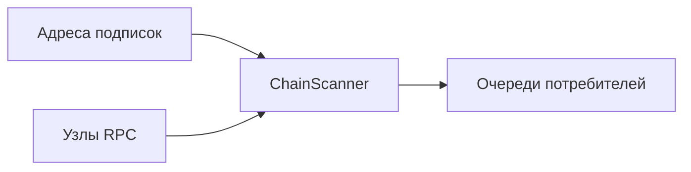

# ChainScanner · Руководство по развёртыванию

[Главная](../../README.ru.md) · [Быстрый старт](#quick-start) · [Сети](#networks) · [Справочник по API](../api/ru.md)

<a id="quick-start"></a>

## Быстрый старт

В корне свежей копии репозитория соберите сервер с Go 1.25 или новее. В примере используется сеть Base и локальная база SQLite. Для команд нужны `openssl`, `curl` и `jq`.

```sh
go build -o chainscanner ./cmd/chainscanner
umask 077
cat > chainscanner.json <<EOF
{
  "listen": "127.0.0.1:9081",
  "database": "chainscanner.sqlite",
  "networks": [{"name": "base", "confirmations": 3}],
  "consumers": {"payments": "$(openssl rand -hex 32)"},
  "admin_token": "$(openssl rand -hex 32)"
}
EOF
./chainscanner -config chainscanner.json
```

Откройте второй терминал в том же каталоге и укажите нужный адрес в сети Base вместо примера. Сохраните полученный `from_height`: транзакции на этой высоте уже входят в подписку.

```sh
BASE=http://127.0.0.1:9081
TOKEN=$(jq -r '.consumers.payments' chainscanner.json)
ADDRESS=0x1111111111111111111111111111111111111111
jq -nc --arg a "$ADDRESS" '[{network:"base",address:$a}]' |
  curl -sS -X PUT "$BASE/v1/subscriptions" -H "Authorization: Bearer $TOKEN" -H 'Content-Type: application/json' --data-binary @-
```

Прочитайте очередь. Пустой ответ HTTP 204 означает, что за время ожидания подходящих событий не поступило. Получив событие, сначала сохраните результат обработки, затем подтвердите его `id` по инструкции в справочнике API.

```sh
curl -i -sS -H "Authorization: Bearer $TOKEN" "$BASE/v1/events/next?network=base&wait=15"
```

[Справочник по API](../api/ru.md)

<a id="configuration"></a>

## Настройка

| Параметр | Описание |
| --- | --- |
| `listen` | По умолчанию `127.0.0.1:9081`. При внешнем доступе используйте TLS для защиты Bearer-токенов. |
| `database` | Без этого параметра данные хранятся в памяти. Файл сохраняет подписки, пропуски и неподтверждённые события при перезапуске. Храните файл и его WAL на постоянном томе. С файлом работает один процесс. |
| `networks[].name` · `url` | Укажите каждую сеть один раз. При запуске предпочтение отдаётся заданному URL. Если в каталоге есть узлы сети, достаточно её имени. |
| `confirmations` | Глубина подтверждения. Верхняя граница сканирования равна `tip - max(confirmations - 1, 0)`. В L2 учитываются блоки самой L2. |
| `lookback` | Положительное значение включает недавнюю подтверждённую историю при активации. По умолчанию отсчёт начинается со следующей высоты после наблюдаемой вершины. |
| `interval_seconds` | Интервал опроса, по умолчанию 5 секунд. Потоковые уведомления также пробуждают обработчик при появлении новой высоты. |
| `protocol` · `api_key` · `history_url` · `history_api_key` | Выберите интерфейс из таблицы. Для парных транспортов укажите `history_url`. У каждого URL свои учётные данные. |
| `trace_calls` | Включает данные о внутренних вызовах EVM через JSON-RPC уровня исполнения. Узел должен поддерживать call tracer. |
| `consumers` · `admin_token` | Каждому потребителю назначается свой токен длиной от 24 байт. Отдельный токен администратора открывает управление узлами. |
| `blacklist` | `keyword:acme` ищет подстроку в имени узла без учёта регистра, `exact:rpc.example.org` задаёт точное имя, домен без префикса включает поддомены. Формат общий для конфигурации и обоих методов API. Пути, параметры и ключи доступа не проверяются. [API](../api/ru.md#blacklist) |

<a id="networks"></a>

## Сети и протоколы

Для 12 основных сетей EVM используется общий адаптер. Укажите конкретную сеть для каждого узла и адреса: при подключении проверяется chain ID. Поддерживаются JSON-RPC через HTTP или WebSocket, локальный IPC и GraphQL, совместимый с Geth. Для Ethereum доступен также Beacon SSE в паре с HTTP уровня исполнения.

| Сеть | ID | Chain ID |
| --- | --- | --- |
| Ethereum | `ethereum` | 1 |
| Arbitrum One | `arbitrum` | 42161 |
| BNB Smart Chain | `binance` | 56 |
| Avalanche C-Chain | `avalanche` | 43114 |
| Polygon PoS | `polygon` | 137 |
| OP Mainnet | `optimism` | 10 |
| Base | `base` | 8453 |
| HyperEVM | `hyperevm` | 999 |
| Monad | `monad` | 143 |
| Arc | `arc` | 5042 |
| Plasma | `plasma` | 9745 |
| Robinhood Chain | `robinhood` | 4663 |

| Сеть | Протоколы | События и история |
| --- | --- | --- |
| `bitcoin` | `jsonrpc` · `http` | Потраченные выходы, получатели и сдача. Нужны полные блоки с данными undo. |
| `tron` | `http` · `rest` · `grpc` · `solidity-http` · `solidity-grpc` · `jsonrpc` | Переводы Wallet, квитанции и внутренние переводы. WalletSolidity читает закреплённые блоки. Для JSON-RPC нужен исторический Wallet HTTP. |
| `solana` | `http` · `jsonrpc` · `ws` · `grpc` | Финализированные слоты, счета транзакций и владельцы SPL. Для полных блоков и пропущенных слотов PubSub и Yellowstone используют HTTP-историю. |
| `sui` | `grpc` · `graphql` | Нативные контрольные точки Move, отправители, спонсоры, владельцы и события. По умолчанию HTTPS использует gRPC v2. |
| `aptos` | `http` · `rest` · `grpc` · `graphql` | Версии нативного реестра Move, подписанты, события и наборы записей. Для RawData gRPC и Indexer GraphQL нужна история через REST полного узла. |
| `ton` | `lite` · `rest` · `jsonrpc` | Транзакции мастерчейна и шардов, счета и адреса сообщений. Lite принимает URL глобальной конфигурации или адрес узла вида `adnl://IP:порт/публичный-ключ-base64url`. Состояние и повторы отслеживаются отдельно для каждого встроенного узла. TON Center v2 использует `/api/v2` или `/api/v2/jsonRPC` и должен возвращать BOC блоков. |

```json
{
  "name": "solana",
  "protocol": "ws",
  "url": "wss://api.mainnet-beta.solana.com",
  "history_url": "https://api.mainnet-beta.solana.com"
}
```

<a id="recovery"></a>

## Сканирование и восстановление



Первая подписка запускает обработчик сети. При удалении последнего адреса фиксируется конечный блок включительно. Обработчик дожидается подтверждений, заполняет пропуски и ставит события в очередь, затем останавливается и очищает курсор и пропуски. События доступны до подтверждения получения. Файловая база сохраняет работу при перезапуске. В режиме памяти потребителю нужна сверка за время простоя.

Если блок 101 пропущен, события из 102 и 103 уже можно получить. API высоты вернёт 100, пока не обработан 101. Новая подписка начинается после наибольшей назначенной высоты; для старых пропусков действуют прежние границы подписок.

Для каждой сети планировщик хранит до 32 незавершённых диапазонов и одновременно использует до 8 разных узлов истории. По уведомлению или таймеру он проверяет высоту и задержку узла. Для диапазона с последним блоком B нужна свежая высота не ниже B + число подтверждений − 1. При четырёх подтверждениях узел на высоте 105 может читать до блока 102. Устаревшее измерение обновляется. Отстающие узлы могут заполнять более ранние пропуски. Освободившийся узел сразу получает новые блоки, даже если старый запрос ещё выполняется. После ошибки или тайм-аута диапазон передаётся другому подходящему узлу. Интерфейсы с общим URL истории читают по очереди.

После каждых трёх последовательных ошибок одной операции узел приостанавливается на 1, 3, 6, 10, 15 минут и далее, максимум на час. Успешное чтение высоты сбрасывает только счётчик высоты, успешное чтение диапазона — оба счётчика.

Автономный сервер обновляет ChainList при запуске и каждые 15 минут, даже когда сканирование приостановлено. Для публичных EVM-узлов HTTPS/WSS проверяются chain ID и свежие заголовки. Записи оператора сохраняются, при ошибке загрузки остаётся прежний каталог. Запись Bitcoin UniSat поддерживает только проверку высоты.

При запуске и каждые 15 минут сервис ищет в CompareNodes бесплатные узлы основных сетей, доступные без ключа. Для каждой поддерживаемой сети он проверяет протокол, идентификатор сети и чтение недавнего блока анонимным запросом. При ошибке загрузки или разбора страницы сохраняется предыдущий список. Удаление из каталога затрагивает только узлы, добавленные из CompareNodes. Коммерческое использование каталога требует разрешения согласно [условиям CompareNodes](https://www.comparenodes.com/terms-of-use/).

Для Solana, Sui, Aptos и TON дополнительным источником служит OpenChainBench. Каждые 15 минут сервер запрашивает публичный HTTP API и описания рейтингов, затем проверяет чтение недавних транзакций. Каждый каталог управляет своими узлами. Если узел не проходит проверку или исчезает из каталога, его исключают из пула. При ошибке загрузки сохраняется предыдущий список для этой сети. [OpenChainBench](https://openchainbench.com/benchmarks)

<details>
<summary>Протоколы узлов</summary>

Для gRPC с TLS используйте `grpcs://host:port` или `https://host:port`, для открытого соединения — `grpc://host:port`. Ethereum Beacon SSE использует путь `/eth/v1/events`, IPC — локальный сокет Unix, GraphQL — полный URL. Узел исполнения с WebSocket должен поддерживать и обычные запросы RPC.

В EVM сравниваются адреса сторон транзакции, созданных контрактов, источников логов и индексированных тем в формате адреса. Трассировка позволяет видеть внутренние вызовы без логов. Arbitrum Nova, торговля HyperCore и цепочки Avalanche X/P используют отдельные реестры. Совпадение возможно для исходящей или неуспешной транзакции; перед зачислением проверьте данные.

</details>

<a id="go"></a>

## Интеграция с Go

Импортируйте корневой пакет, чтобы встроить сканер или воспользоваться HTTP-клиентом. Запускайте тесты с детектором гонок из корня репозитория.

```go
import scanner "github.com/GMWalletApp/ChainScanner"
```

```sh
go test -race ./...
```

[Справочник по API](../api/ru.md) · [scanner.go](https://github.com/GMWalletApp/ChainScanner/blob/main/scanner.go) · [MIT](https://github.com/GMWalletApp/ChainScanner/blob/main/LICENSE)
