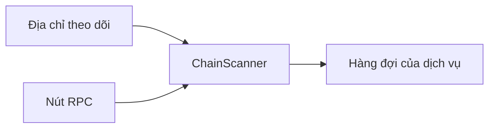

# ChainScanner · Hướng dẫn triển khai

[Trang chủ](../../README.vi.md) · [Khởi động nhanh](#quick-start) · [Mạng hỗ trợ](#networks) · [Tài liệu API](../api/vi.md)

<a id="quick-start"></a>

## Khởi động nhanh

Từ thư mục gốc của bản sao kho mã mới, biên dịch bằng Go 1.25 trở lên. Ví dụ bật mạng Base và lưu trạng thái vào SQLite trên máy. Các lệnh dùng `openssl`, `curl` và `jq`.

```sh
go build -o chainscanner ./cmd/chainscanner
umask 077
cat > chainscanner.json <<EOF
{
  "listen": "127.0.0.1:9081",
  "database": "chainscanner.sqlite",
  "networks": [{"name": "base", "confirmations": 3}],
  "consumers": {"payments": "$(openssl rand -hex 32)"},
  "admin_token": "$(openssl rand -hex 32)"
}
EOF
./chainscanner -config chainscanner.json
```

Mở terminal thứ hai tại cùng thư mục và thay địa chỉ mẫu bằng địa chỉ Base cần theo dõi. Lưu `from_height` trong kết quả; giao dịch ngay tại độ cao này cũng thuộc phạm vi đăng ký.

```sh
BASE=http://127.0.0.1:9081
TOKEN=$(jq -r '.consumers.payments' chainscanner.json)
ADDRESS=0x1111111111111111111111111111111111111111
jq -nc --arg a "$ADDRESS" '[{network:"base",address:$a}]' |
  curl -sS -X PUT "$BASE/v2/subscriptions" -H "Authorization: Bearer $TOKEN" -H 'Content-Type: application/json' --data-binary @-
```

Đọc hàng đợi. HTTP 204 với nội dung trống nghĩa là chưa có sự kiện khớp trong thời gian chờ. Khi nhận được sự kiện, hãy lưu kết quả xử lý trước rồi xác nhận `id` theo tài liệu API.

```sh
curl -i -sS -H "Authorization: Bearer $TOKEN" "$BASE/v2/events/next?network=base&wait=15"
```

[Tài liệu API](../api/vi.md)

<a id="configuration"></a>

## Cấu hình

| Tham số | Ý nghĩa |
| --- | --- |
| `listen` | Mặc định là `127.0.0.1:9081`. Dùng TLS khi công khai API xác thực bằng Bearer token. |
| `database` | Bỏ trống để chạy trong bộ nhớ. Dùng tệp để giữ đăng ký, khoảng thiếu và sự kiện chưa xác nhận sau khi khởi động lại. Lưu cả tệp và WAL trên ổ bền vững; mỗi tệp chỉ dùng cho một tiến trình. |
| `networks[].name` · `url` | Khai báo mỗi mạng một lần. URL cấu hình được ưu tiên khi khởi động. Với mạng đã có nút trong danh mục, chỉ cần khai báo tên. |
| `confirmations` | Độ sâu cần đạt trước khi giao sự kiện. Giới hạn quét là `tip - max(confirmations - 1, 0)`. Trên L2, đơn vị là khối của L2. |
| `lookback` | Giá trị dương cho phép đọc lại lịch sử gần nhất đã đủ xác nhận khi kích hoạt. Mặc định bắt đầu từ độ cao ngay sau đầu chuỗi quan sát được. |
| `interval_seconds` | Chu kỳ thăm dò, mặc định 5 giây. Với giao thức hỗ trợ luồng, đầu chuỗi mới cũng đánh thức bộ quét. |
| `protocol` · `api_key` · `history_url` · `history_api_key` | Chọn giao thức trong bảng bên dưới. Điền `history_url` cho giao thức dùng nút lịch sử riêng. Thông tin xác thực của hai URL độc lập. |
| `trace_calls` | Bật thu thập lời gọi nội bộ EVM qua JSON-RPC tầng thực thi trên nút hỗ trợ call tracer. |
| `consumers` · `admin_token` | Ánh xạ tên dịch vụ sang token riêng, mỗi token ít nhất 24 byte. Token quản trị riêng bật chức năng quản lý nút. |

<a id="networks"></a>

## Mạng và giao thức

13 mạng chính EVM dùng chung bộ đọc. Mỗi đăng ký và mỗi nút phải chỉ rõ mạng; kết nối sẽ kiểm tra chain ID. Tất cả hỗ trợ JSON-RPC qua HTTP hoặc WebSocket, IPC cục bộ và GraphQL tương thích Geth. Ethereum còn hỗ trợ Beacon SSE ghép với HTTP tầng thực thi.

| Mạng | ID | Chain ID | Mạng | ID | Chain ID |
| --- | --- | --- | --- | --- | --- |
| Ethereum | `ethereum` | 1 | Base | `base` | 8453 |
| Arbitrum One | `arbitrum` | 42161 | HyperEVM | `hyperevm` | 999 |
| BNB Smart Chain | `binance` | 56 | Monad | `monad` | 143 |
| Avalanche C-Chain | `avalanche` | 43114 | Arc | `arc` | 5042 |
| Polygon PoS | `polygon` | 137 | Morph | `morph` | 2818 |
| OP Mainnet | `optimism` | 10 | Robinhood Chain | `robinhood` | 4663 |
| Plasma | `plasma` | 9745 |  |  |  |

| Mạng | Giao thức | Hoạt động và lịch sử |
| --- | --- | --- |
| `tron` | `http` · `rest` · `grpc` · `solidity-http` · `solidity-grpc` · `jsonrpc` | Giao dịch Wallet, biên nhận và chuyển nội bộ. WalletSolidity đọc khối đã xác nhận; JSON-RPC cần URL lịch sử Wallet HTTP. |
| `solana` | `http` · `jsonrpc` · `ws` · `grpc` | Quét slot đã hoàn tất, tài khoản giao dịch và chủ sở hữu SPL. PubSub và Yellowstone cần lịch sử HTTP để đọc khối đầy đủ và nhận biết slot bị bỏ qua. |
| `sui` | `grpc` · `graphql` | Checkpoint Move gốc, người gửi, nhà tài trợ, chủ sở hữu và sự kiện. HTTPS dùng gRPC v2 theo mặc định. |
| `aptos` | `http` · `rest` · `grpc` · `graphql` | Phiên bản sổ cái Move gốc, bên ký, sự kiện và tập thay đổi. RawData gRPC và Indexer GraphQL đều cần REST của fullnode để đọc lịch sử. |
| `ton` | `lite` · `rest` · `jsonrpc` | Hoạt động masterchain và shard, tài khoản và hai đầu thông điệp. Lite dùng URL cấu hình toàn cục. TON Center v2 dùng `/api/v2` hoặc `/api/v2/jsonRPC` và phải trả về BOC của khối. |

```json
{
  "name": "solana",
  "protocol": "ws",
  "url": "wss://api.mainnet-beta.solana.com",
  "history_url": "https://api.mainnet-beta.solana.com"
}
```

<a id="recovery"></a>

## Quét và khôi phục



Đăng ký đầu tiên khởi động bộ quét của mạng. Khi bỏ địa chỉ cuối cùng, việc đọc dừng lại và tiến độ cùng các khoảng thiếu được xóa. Sự kiện đã xếp hàng vẫn còn. Ở chế độ bộ nhớ, đăng ký lại sau khi khởi động và đối soát quãng gián đoạn từ dữ liệu của dịch vụ.

Nếu thiếu khối 101, dịch vụ vẫn có thể nhận hoạt động từ 102 và 103. API độ cao giữ ở 100 cho đến khi hoàn tất 101. Đăng ký mới bắt đầu sau độ cao cao nhất đã phân công, nên các khoảng thiếu cũ vẫn giữ ranh giới đăng ký ban đầu.

Mỗi mạng giữ tối đa 32 khoảng đang chờ và dùng đồng thời tối đa 8 nút lịch sử khác nhau. Khi có thông báo hoặc đến kỳ thăm dò, bộ điều phối kiểm tra độ cao và độ trễ của nút. Để quét khoảng kết thúc tại B, độ cao mới đo phải đạt ít nhất B + số lần xác nhận − 1. Với bốn lần xác nhận, nút ở độ cao 105 có thể quét đến 102. Nếu kết quả đo đã cũ, nút được kiểm tra lại. Nút chậm hơn vẫn có thể bù các khối cũ. Khi một yêu cầu hoàn tất, nút rảnh có thể quét khối mới dù yêu cầu trước vẫn đang chạy. Khi có lỗi hoặc hết thời gian chờ, một nút đủ điều kiện khác sẽ thử lại. Các giao thức dùng chung URL lịch sử đọc luân phiên.

Cứ ba lần lỗi liên tiếp của cùng thao tác, nút tạm nghỉ lần lượt 1, 3, 6, 10, 15 phút và tăng dần, tối đa một giờ. Đọc độ cao thành công chỉ xóa chuỗi lỗi độ cao; đọc thành công một khoảng xóa cả hai chuỗi.

Máy chủ độc lập cập nhật ChainList lúc khởi động và mỗi 15 phút, kể cả khi bộ quét đang nghỉ. Nó kiểm tra nút EVM HTTPS/WSS công khai, chain ID và header gần đây, đồng thời giữ các mục của người vận hành. Nếu tải danh mục lỗi, danh sách trước vẫn có hiệu lực. Mục Bitcoin UniSat chỉ dùng để kiểm tra độ cao.

<details>
<summary>Chi tiết giao thức và nâng cấp</summary>

Với gRPC qua TLS, dùng `grpcs://host:port` hoặc `https://host:port`; kết nối không mã hóa dùng `grpc://host:port`. Ethereum Beacon SSE dùng tuyến `/eth/v1/events`, IPC nhận Unix socket cục bộ, còn GraphQL cần URL đầy đủ. Nút thực thi WebSocket cũng phải hỗ trợ các lệnh đọc RPC thông thường.

EVM đối chiếu hai đầu giao dịch, hợp đồng được tạo, nguồn phát log và topic được lập chỉ mục có dạng địa chỉ. Trace tùy chọn ghi nhận cả lời gọi nội bộ không có log. Arbitrum Nova, giao dịch HyperCore và Avalanche X/P dùng sổ cái riêng. Một giao dịch khớp có thể là giao dịch đi hoặc đã thất bại; hãy kiểm tra trước khi ghi có.

Nếu bản cũ dùng tệp mặc định, hãy đặt `database` thành đường dẫn ban đầu của tệp (ví dụ `chainscanner.sqlite`) trước khi nâng cấp. Đăng ký v1 cũ có thể chỉ nhận được mốc độ cao khi đăng ký v2 lần đầu.

</details>

<a id="go"></a>

## Tích hợp Go

Nhập gói gốc để nhúng bộ quét hoặc dùng HTTP client đi kèm. Chạy bộ kiểm thử có phát hiện tranh chấp dữ liệu tại thư mục gốc.

```go
import scanner "github.com/GMWalletApp/ChainScanner"
```

```sh
go test -race ./...
```

[Tài liệu API](../api/vi.md) · [scanner.go](https://github.com/GMWalletApp/ChainScanner/blob/main/scanner.go) · [MIT](https://github.com/GMWalletApp/ChainScanner/blob/main/LICENSE)
