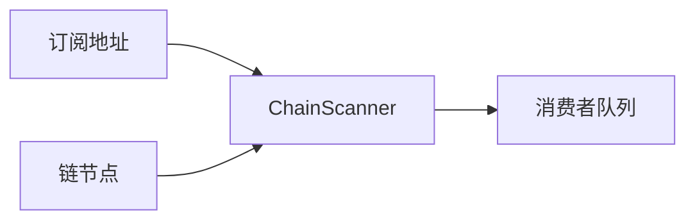

# ChainScanner · 部署指南

[首页](../../README.zh-CN.md) · [快速开始](#quick-start) · [支持的网络](#networks) · [接口文档](../api/zh-CN.md)

<a id="quick-start"></a>

## 快速开始

在仓库根目录使用 Go 1.25 或更高版本构建服务。以下示例启用 Base，将状态保存到本地 SQLite 文件。命令需要 `openssl`、`curl` 和 `jq`；请在新的检出目录中运行。

```sh
go build -o chainscanner ./cmd/chainscanner
umask 077
cat > chainscanner.json <<EOF
{
  "listen": "127.0.0.1:9081",
  "database": "chainscanner.sqlite",
  "networks": [{"name": "base", "confirmations": 3}],
  "consumers": {"payments": "$(openssl rand -hex 32)"},
  "admin_token": "$(openssl rand -hex 32)"
}
EOF
./chainscanner -config chainscanner.json
```

在同一目录打开第二个终端，把示例地址换成要监听的 Base 地址。保存返回的 `from_height`，这个高度本身也在订阅范围内。

```sh
BASE=http://127.0.0.1:9081
TOKEN=$(jq -r '.consumers.payments' chainscanner.json)
ADDRESS=0x1111111111111111111111111111111111111111
jq -nc --arg a "$ADDRESS" '[{network:"base",address:$a}]' |
  curl -sS -X PUT "$BASE/v1/subscriptions" -H "Authorization: Bearer $TOKEN" -H 'Content-Type: application/json' --data-binary @-
```

读取队列。等待期间没有匹配事件时返回 HTTP 204，响应体为空。收到投递后，先持久化业务结果，再按接口参考确认该投递的 `id`。

```sh
curl -i -sS -H "Authorization: Bearer $TOKEN" "$BASE/v1/events/next?network=base&wait=15"
```

[接口参考](../api/zh-CN.md)

<a id="configuration"></a>

## 配置

| 配置项 | 行为 |
| --- | --- |
| `listen` | 默认监听 `127.0.0.1:9081`。对外提供基于 Bearer 令牌的接口时使用 TLS。 |
| `database` | 省略时使用内存。指定文件可在重启后恢复订阅、缺块和未确认投递。数据库及其 WAL 应放在持久卷上，一个文件只能由一个进程持有。 |
| `networks[].name` · `url` | 每个具体网络配置一次。启动时优先使用配置的 URL。有可用目录节点的网络可以只填写名称。 |
| `confirmations` | 投递所需的确认深度。可扫上限为 `tip - max(confirmations - 1, 0)`。在 L2 上按该 L2 的区块计算。 |
| `lookback` | 正数表示首次激活时回看最近已满足确认深度的历史。默认从注册时观察到的链头下一高度开始。 |
| `interval_seconds` | 轮询间隔，默认 5 秒。支持推送的节点还可在出现新高度时唤醒活跃的工作线程。 |
| `protocol` · `api_key` · `history_url` · `history_api_key` | 按下表选择接口。需要历史节点的协议必须填写 `history_url`，其凭证与主节点独立。 |
| `trace_calls` | 通过执行层 JSON-RPC 和支持 call tracer 的节点采集 EVM 内部调用证据。 |
| `consumers` · `admin_token` | 消费者名称映射到各自的令牌，每个至少 24 字节。另设独立的管理员令牌即可启用节点管理。 |
| `blacklist` | `keyword:acme` 按主机名做不区分大小写的子串匹配；`exact:rpc.example.org` 只封禁完整主机名；直接填写域名则同时封禁子域名。配置文件和添加、移除接口使用同一种写法。关键词不匹配 URL 路径、查询参数或凭据。 [API](../api/zh-CN.md#blacklist) |

<a id="asset-events"></a>

### EVM 代币事件

扫描器复用扫块时已经读取的日志。Ethereum 主网内置 Aave V3 Core Pool 的 `Supply` 规则，可以匹配非索引的操作人 `user`。监听 Lido stETH 全局余额调整时，订阅一次 stETH 代币合约地址；收到 `TokenRebased` 时，`activity.data.refresh_assets` 含 stETH 的合约地址，余额服务可据此重查自己跟踪的 stETH 持有人。只订阅个人钱包无法匹配未提及该钱包的 rebase。每笔交易对同一资产只提示一次，提示不含入账金额。[Aave 事件 ABI](https://github.com/aave/aave-v3-core/blob/master/contracts/interfaces/IPool.sol) · [stETH 集成说明](https://docs.lido.fi/guides/lido-tokens-integration-guide/)

其他可信合约可在对应的 `networks` 配置项添加 `asset_events`。两级键分别为发出日志的合约地址（代理合约使用代理地址）和事件签名的 32 字节 Keccak 哈希。下例对应 `event RewardPaid(address beneficiary, uint256 amount)`，两个参数都未标记 `indexed`。使用时将示例地址替换为实际奖励合约。

```json
{
  "name": "base",
  "asset_events": {
    "0x2222222222222222222222222222222222222222": {
      "0xe2403640ba68fed3a2f88b7557551d1993f84b99bb10ff833f0cf8db0c5e0486": {
        "topics": 1,
        "data_words": 2,
        "address_words": [0]
      }
    }
  }
}
```

`topics` 为完整主题数，包含签名。`data_words` 为静态数据的 32 字节字数。`address_words` 指明经 ABI 核实的地址参数位置，从 0 开始。若发出事件的代币合约调整全局余额，可设 `refresh_asset: true`。每条规则至少指定一个地址位置或启用刷新提示。同链、同合约、同签名的自定义规则优先于内置规则。目前支持固定长度的事件数据。

<a id="networks"></a>

## 网络与节点协议

12 个 EVM 主网共用适配器。配置订阅或节点时必须指定具体网络，连接时会校验执行层 chain ID。均支持 HTTP 或 WebSocket JSON-RPC、本地 IPC 和兼容 Geth 的 GraphQL。Ethereum 还支持 Beacon SSE 配对执行层 HTTP。

| 网络 | ID | Chain ID |
| --- | --- | --- |
| Ethereum | `ethereum` | 1 |
| Arbitrum One | `arbitrum` | 42161 |
| BNB Smart Chain | `binance` | 56 |
| Avalanche C-Chain | `avalanche` | 43114 |
| Polygon PoS | `polygon` | 137 |
| OP Mainnet | `optimism` | 10 |
| Base | `base` | 8453 |
| HyperEVM | `hyperevm` | 999 |
| Monad | `monad` | 143 |
| Arc | `arc` | 5042 |
| Plasma | `plasma` | 9745 |
| Robinhood Chain | `robinhood` | 4663 |

| 网络 | 协议 | 活动与历史数据 |
| --- | --- | --- |
| `bitcoin` | `jsonrpc` · `http` | 从前序输出、收款及找零脚本匹配地址。节点需提供区块及 undo 数据。 |
| `tron` | `http` · `rest` · `grpc` · `solidity-http` · `solidity-grpc` · `jsonrpc` | Wallet 转账、回执及内部转账。WalletSolidity 读取已固化区块；JSON-RPC 需要配对 Wallet HTTP 历史节点。 |
| `solana` | `http` · `jsonrpc` · `ws` · `grpc` | 按最终确认的 slot 扫描交易账户与 SPL 所有者。PubSub 和 Yellowstone 需配对 HTTP 节点查询完整区块并识别跳过的 slot。 |
| `sui` | `grpc` · `graphql` | 原生 Move 检查点、发送方、赞助方、所有者和事件。HTTPS 默认使用 gRPC v2。 |
| `aptos` | `http` · `rest` · `grpc` · `graphql` | 原生 Move 账本版本、签名人、事件及写集。RawData gRPC 和 Indexer GraphQL 都需配对全节点 REST 历史接口。 |
| `ton` | `lite` · `rest` · `jsonrpc` | 主链和分片中的交易账户及消息端点。Lite 支持全局配置 URL，也可用 `adnl://IP:端口/base64url公钥` 直连。每个内置主网节点独立记录健康状态和重试时间。TON Center v2 使用 `/api/v2` 或 `/api/v2/jsonRPC`，节点需提供区块 BOC。 |

```json
{
  "name": "solana",
  "protocol": "ws",
  "url": "wss://api.mainnet-beta.solana.com",
  "history_url": "https://api.mainnet-beta.solana.com"
}
```

<a id="recovery"></a>

## 扫块与恢复



首个地址启动对应链。最后一个地址退订时固定终止块，扫描器等待确认并补齐此前缺块，将截至终止块（含）的匹配事件入队后，才停止该链并清除游标和缺块记录。未确认的事件仍可领取。配置数据库文件可在重启后继续补扫；内存模式下，中断期间由消费者对账。

即使缺少 101 块，102 和 103 的活动也能立即投递。高度接口在 101 补齐前仍返回 100。新地址从已分配的最高高度之后开始监听，旧缺口继续沿用原来的订阅边界。

每条链最多保留 32 个待处理区间，最多并发使用 8 个不同的历史节点。收到新区块通知或到达轮询时间时，调度器用空闲节点查高度。对直连节点，同一次响应也更新健康状态和延迟。分配区间时按末块判断资格：节点最近的高度必须达到「区间末块 + 确认数 − 1」。例如要求 4 次确认，报到 105 的节点可以扫到 102，报到 106 的节点可以扫到 103。高度未知或观测过期时先探测，高度较低的节点可以补历史缺口。

每个请求完成就腾出位置接新任务。即使旧请求仍在进行，其他节点也能扫描并投递新确认的区块。读块出错或超时后，调度器在其他合格节点重试。共享历史 URL 的接口轮流读取。Solana 的每个历史节点可复用最多 16 个已最终确认的 slot 列表，读块和投递仍逐 slot 进行。

代码按职责组织。`internal/nodes/live.go` 管理订阅期间的任务队列，`health.go` 复用高度观测，`worker.go` 执行节点读取。`internal/engine` 记录待补区间并提交匹配的投递，`internal/feed` 提供 HTTP、WebSocket 和 gRPC 接口。

同一操作每连续失败三次，节点依次冷却 1、3、6、10、15 分钟，以此递增，单次上限一小时。查高度成功只清除高度失败记录，读区间成功会重置两类记录。

独立服务启动时及之后每 15 分钟刷新 ChainList，即使没有地址订阅也会进行节点发现。它探测公开 EVM HTTPS/WSS 节点，校验 chain ID 和近期块头，保留手动配置的节点。目录下载失败时沿用上次清单。UniSat 的 Bitcoin 条目仅支持高度探测。

服务启动时及之后每 15 分钟从 CompareNodes 补充各条链免费、免密钥的主网节点。服务逐链读取目录页，按协议筛选，并通过匿名请求核对主网、实读近期区块。某条链的目录获取或解析失败时，保留其上次结果。目录下架仅移除 CompareNodes 自己引入的节点。商业使用目录前需取得授权，详见 [CompareNodes 使用条款](https://www.comparenodes.com/terms-of-use/)。

Solana、Sui、Aptos 和 TON 还通过 OpenChainBench 发现节点。服务每 15 分钟请求其公开 HTTP 接口和榜单定义，验证节点能读取近期主网交易后才加入调度。每个目录独立管理自己的条目。节点验证失败或从上游下架后移出调度；目录下载失败时保留该链上一次的结果。 [OpenChainBench](https://openchainbench.com/benchmarks)

<details>
<summary>节点协议细节</summary>

TLS gRPC 可用 `grpcs://host:port` 或 `https://host:port`；明文使用 `grpc://host:port`。Ethereum Beacon SSE 使用节点的 `/eth/v1/events` 路由，IPC 使用本地 Unix 套接字，GraphQL 需填写完整接口 URL。WebSocket 执行节点也要支持常规 RPC 读取。

EVM 匹配包括交易双方、创建的合约、日志发出方和形似地址的索引主题；开启追踪后还可获取无日志的内部调用。Arbitrum Nova、HyperCore 交易和 Avalanche X/P 链属于其他账本。匹配的交易可能转出或执行失败，入账前应核对证据。

</details>

<a id="go"></a>

## Go 集成

可导入根包嵌入扫描器，也可使用其中的 HTTP 客户端。在仓库根目录运行带竞态检测的测试。

```go
import scanner "github.com/GMWalletApp/ChainScanner"
```

```sh
go test -race ./...
```

[接口参考](../api/zh-CN.md) · [scanner.go](https://github.com/GMWalletApp/ChainScanner/blob/main/scanner.go) · [MIT](https://github.com/GMWalletApp/ChainScanner/blob/main/LICENSE)
